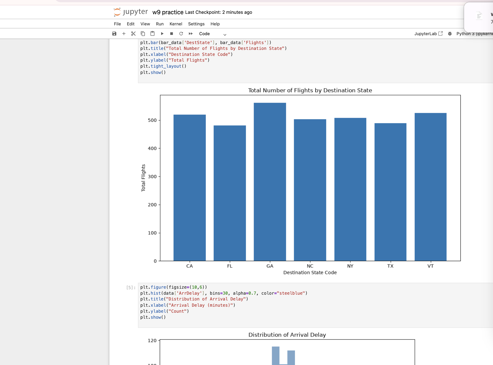
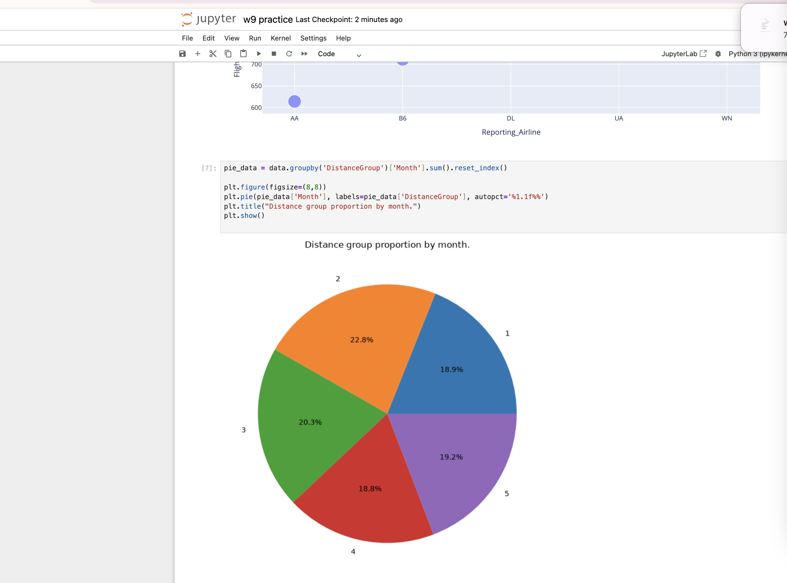

# My Data Science Portfolio
## About Me
Name: WANG LIYUAN
Student ID: MC644791

I am a master student majoring in Data Analytics. I am proficient in Python for data generation, data cleaning, exploratory data analysis and visualization. I have hands-on experience with Pandas, Matplotlib and Plotly. I also know how to manage GitHub repositories and publish static websites with GitHub Pages.

## Project Showcase: Flight Delay Data Analysis
**Project Name & Research Question**: Flight data exploration, investigating how month, destination state and airline affect flight volume and arrival delay.

**Visualization of Research Results**:

> Figure: Bar chart of total flight numbers for each destination state

> Figure: Pie chart showing distance group proportion by month

**Project Repository Link**:
https://github.com/wangliyuan231-ops/data-science-project

**Project Status**: Completed
